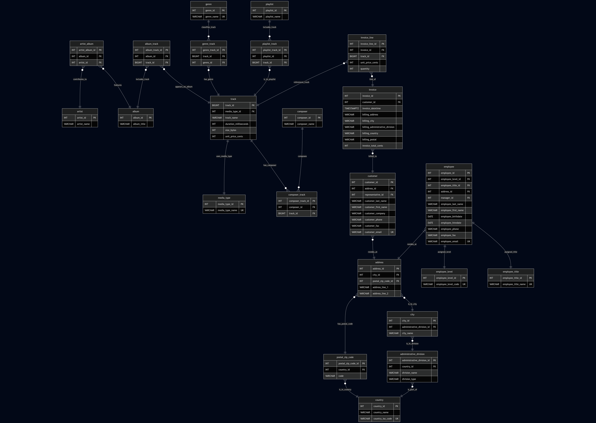

# Project Overview

## Project Title
Music Database Redesign & Analytical Exploration

## Project Author
Theofilos P. Theodoridis

## Project Status
Completed – Version 1.0

## Summary
This project transforms a legacy music store database into a clean, analysis‑ready data model designed for modern BI tools.  
The original schema contained duplicated information, inconsistent relationships, and structural issues that made business insights unreliable.

A new normalized database was rebuilt in PostgreSQL using a Third Normal Form (3NF) approach, that focuses on analytical clarity, data quality  
and business driven modeling decisions. It prepares the dataset for advanced reporting in Power BI, including revenue analysis, customer segmentation, product performance and geographic insights.

The following sections outline the project’s context, methodology and structure.

## Table of Contents
- [Background](#background)
- [Why This Matters for Analysis](#why-this-matters-for-analysis)
- [Objectives](#objectives)
- [Tools & Technologies](#tools--technologies)
- [Environment Configuration](#environment-configuration)
- [Repository Structure](#repository-structure)
- [Legacy Schema Overview](#legacy-schema-overview)
- [Design Decisions](#design-decisions)
- [Data Quality Checks Performed](#data-quality-checks-performed)
- [Data Issues & Limitations](#data-issues--limitations)
- [Genre Normalization](#genre-normalization)
- [Composer Normalization](#composer-normalization)
- [Artist Normalization](#artist-normalization)
- [ETL Pipeline](#etl-pipeline)
- [New Database Design Overview](#new-database-design-overview)
- [New Database Schema](#new-database-schema)
- [Benchmarking the Old vs. New Schema](#benchmarking-the-old-vs-new-schema)
- [Conclusions](#conclusions)
- [Next Steps](#next-steps)
- [Project Files & Reference Material](#project-files--reference-material)
- [Contact](#contact)
- [Acknowledgments](#acknowledgments)
- [License](#license)

With the structure in place, let's examine the background and motivation behind the project.

## Background
The project began with an analytical assessment of a publicly available music store dataset.  
To evaluate the original schema, I ran a set of queries that tested its ability to support analytical tasks.

The results exposed several structural issues that directly blocked meaningful analysis.  
These were problems that would mislead dashboards, distort KPIs, and undermine any attempt to provide meaningful business decisions.

With the limitations clearly identified, the project shifted from evaluation to analytical reconstruction.

The redesigned schema provides a stable foundation for BI work, enabling deeper insights such as churn indicators, cohort analysis and customer lifetime value.  

Building on this context, we now move to the importance of the modeling changes.

## Why This Matters for Analysis
Most datasets appear usable at first glance, until you try to answer real business questions.  
This project highlights the analytical judgment required to uncover hidden issues, and reshape imperfect data into useful insights.

Key reasons this redesign matters:
* Analysts rarely receive clean data, so they need to be able to diagnose inconsistencies and transform data so reporting is trustworthy.

* BI tools depend on clean relationships, so the new schema simplifies joins and enforces consistent keys.

* Business questions become easier to answer once the data is structured for analysis.

With the analytical challenges clearly defined, the next step is to establish the project's objectives.

## Objectives
The main goal of this project is to redesign the original music store database into a clean, analysis‑ready model that supports reliable analysis and modern BI workflows.

Key objectives:
* Evaluate the original schema to identify structural issues that reduce analytical accuracy.
* Redesign the data model using a 3NF approach that improves consistency and integrity.
* Standardize and migrate data with Python and SQLAlchemy to enforce constraints and consistent values.
* Benchmark analytical performance by comparing representative queries across both schemas to validate improvements.
* Enable advanced analytics including churn analysis, cohort tracking, revenue insights and customer behavior modeling.

Achieving these objectives required a focused selection of tools and technologies.

## Tools & Technologies
The tools used in this project were selected for their ability to support data preparation, schema redesign and analytical validation:
* PostgreSQL: Core database engine used to implement the redesigned schema.
* pgAdmin: Used for schema inspection, query execution, and debugging during development.
* Python & SQLAlchemy: Enabled schema creation, data migration, and enforcement of constraints.
* JupyterLab: Used to run Python scripts for schema generation and data adjustments prior to migration.
* GitHub: Version control, project tracking and documentation.

To run the migration scripts and reproduce the analysis, a minimal environment setup is required.

## Environment Configuration
This project connects to two PostgreSQL databases:
* the original (unnormalized) database
* the normalized database created during migration

To keep credentials secure, the project uses a local `.env` file that is not committed to the repository.

### 1. Create the .env file
In the project root directory, create a file named `.env`  
You can use the `.env.example` file provided in the repository as a template.

### 2. Add your database connection details
Fill in the following variables in your `.env` file:
```
DB_USERNAME=[YOUR_USERNAME]
DB_PASSWORD=[YOUR_PASSWORD]
DB_HOST=[HOST_NAME]
DB_PORT=[PORT_NUMBER]
ORIGINAL_DB_NAME=[ORIGINAL_DB_NAME]
NORMALIZED_DB_NAME=[NORMALIZED_DB_NAME]
```
### 3. Loading environment variables in the code
The project uses python-dotenv to load environment variables:
```
from dotenv import load_dotenv
import os

load_dotenv()

USERNAME = os.getenv("DB_USERNAME")
PASSWORD = os.getenv("DB_PASSWORD")
HOST = os.getenv("DB_HOST")
PORT = os.getenv("DB_PORT")
```
Using the above configuration we connect securely to both databases without exposing credentials in the repository.

With the environment configured, the repository layout below provides a complete overview of the project’s organization.

## Repository Structure
An overview of the repository layout:
```
├── analysis/                     # Benchmark queries, performance tests, analytical SQL
│   ├── benchmark-questions/
│   │
│   ├── explain-analyze-outputs/
│   │     ├── new-schema/
│   │     └── old-schema/
│   │
│   └── query-solutions/
│         ├── new-schema/
│         └── old-schema/
│
│
├── docs/                         # Extended technical documentation
│   ├── data/                     # Legacy issues, normalization, data quality
│   │
│   ├── design/                   # Conceptual design decisions and rationale
│   │
│   ├── etl/                      # Python to PostgreSQL migration pipeline docs
│   │
│   └── schema/                   # Final schema structure, diagrams, constraints
│
├── images/                       # Diagrams and visuals used in the README
│   ├── database-diagrams/
│   │
│   └── screenshots/
│
├── original-database/            # Legacy schema and original dataset files
│
├── src/                          # Python scripts for migration, cleaning, and validation
│
├── .env.example
├── .gitignore
├── LICENSE
└── README.md
```

## Legacy Schema Overview
The original database used a denormalized, inconsistent schema with weak constraints, free‑form text fields, and limited support for  
geographic or financial analysis. It served as a functional tutorial dataset, but not as a reliable foundation for BI workflows or analytical reporting.

Key issues included:
* free‑form addresses with no validation
* floating‑point monetary values
* inconsistent foreign keys
* many‑to‑many relationships modeled incorrectly
* no deletion safeguards
* limited support for geographic or analytical queries

The full legacy schema, including table samples and structural analysis, is documented in <a href="/docs/data/legacy-schema.md" target="_blank">Legacy Schema Technical Analysis</a>.

With these limitations clearly defined, the next step was to establish the design decisions required to build a more reliable analytical model.

## Design Decisions
The redesigned schema aims to improve analytical reliability, data quality, and long‑term scalability.  
Each decision in this section addresses a clear limitation in the original data and helps ensure the new design follows the standards used in modern, reliable systems.

### Monetary Values

#### Decision  
Store all monetary values as integer cents instead of floating‑point numbers.

#### Analytical Reasoning  
The original schema used `DOUBLE PRECISION`, which introduces rounding errors during aggregations.  
Even tiny inaccuracies compound when calculating revenue, customer lifetime value, or cohort monetization.  
For an analyst, this means inconsistent KPIs and unreliable financial reporting.

#### Business Impact
* Accurate revenue metrics across SQL, Python, and Power BI
* Consistent financial calculations for dashboards and exports
* Reliable inputs for churn, CLV, and cohort analysis
* No discrepancies between analytical tools

Additional implementation details are documented in <a href="/docs/design/monetary-values.md" target="_blank">Monetary Values Design Doc</a>.

### Timezones

#### Decision  
Store all timestamps as `UTC` using `TIMESTAMPTZ`, preserving original values but enforcing a consistent reference point.

#### Analytical Reasoning  
The legacy schema used naive timestamps with no timezone context.  
This makes it impossible to know whether the timestamps represent server time, customer local time, or any other standardized reference.

During analysis, this ambiguity breaks:
* cohort boundaries
* churn windows
* hourly activity patterns
* time‑based segmentation

#### Business Impact
* Reliable ordering of customer events
* Consistent time‑based metrics across SQL, Python, and Power BI
* Accurate cohort, retention, and churn analysis
* Predictable compatibility with Power BI and other analytical tools

This decision ensures that time‑based insights are consistent and interpretable, regardless of tool or workflow.

More details about this decision are available in <a href="/docs/design/timezone-normalization.md" target="_blank">Timezone Normalization Design Doc</a>.

### Address Data Normalization & Invoice Billing Address Exception

#### Decision  
Normalize all customer and employee address data into a structured geographic hierarchy  
(`country` -> `postal_zip_code` -> `division` -> `city` -> `address`),  
but preserve invoice billing addresses as embedded fields  
(`billing_address`, `billing_city`, `billing_administrative_division`, `billing_country`, `billing_postal`)  
to maintain historical accuracy.

#### Analytical Reasoning  
The original schema stored addresses as free‑form text, leading to inconsistent spelling, duplicated locations and unreliable geographic grouping.
Normalizing customer and employee addresses eliminates these issues and creates a clean, validated geographic dimension suitable for BI analysis.

However, invoices represent legal, historical documents. If billing addresses were normalized, any future customer address update would  
retroactively alter past invoices, corrupting historical reporting, breaking auditability, and distorting geographic revenue trends.

To balance analytical clarity with historical integrity, the redesign applies normalization everywhere except invoice billing fields, which remain immutable snapshots of the original transaction.

#### Business Impact
* Accurate historical revenue by country/region
* Supports clean customer/employee location reporting while keeping invoices immutable
* Eliminates duplicated or misspelled locations
* Preserves the exact billing information used at the time of purchase
* Avoids retroactive data corruption when customers update their address

This hybrid approach ensures that geographic data remain strict and predictable, creating a trustworthy foundation for BI and reporting.

Additional implementation details are documented in <a href="/docs/design/address-normalization.md" target="_blank">Address Normalization Design Doc</a>.

### Phone Number Normalization

#### Decision  
Retain phone numbers exactly as they appear in the original dataset, without enforcing strict formatting or uniqueness rules.

#### Analytical Reasoning  
The source data contains phone numbers in many formats, with no consistent standard.  
Any attempt to standardize them would introduce assumptions about country codes, formatting rules, or number validity and could risk altering real customer information.  
Phone numbers also aren’t reliable unique identifiers, and enforcing constraints would create false errors.

#### Business Impact
* Preserves original customer and employee contact information
* Avoids incorrect assumptions about international formats
* Supports realistic scenarios where numbers change or are shared
* Ensures that phone numbers can be used for grouping or filtering without risking data loss

This approach keeps the data authentic, practical, and minimally altered, which is often the safest choice for real‑world datasets.

More details about this decision are available in <a href="/docs/design/phone-normalization.md" target="_blank">Phone Normalization Design Doc</a>.

### Invoice Line Design

#### Decision  
Preserve the original event‑based purchase model where each invoice line represents a single purchase action, even if multiple identical tracks are bought within the same invoice.

#### Analytical Reasoning  
The legacy schema treats each purchase as a distinct event, not a grouped quantity.  
Changing this behavior (e.g. aggregating identical items into a single row with a quantity field) would introduce assumptions about how the store processes transactions.  
Altering this structure could distort purchase frequency, and event‑based metrics used during analysis.

#### Business Impact
* Maintains the original meaning of each purchase event
* Supports accurate analysis of purchase frequency and item‑level behavior
* Avoids incorrect aggregation that could distort customer activity patterns
* Ensures consistency with the source system’s transactional logic

This preserves the dataset’s behavioral integrity, which is essential for customer analytics and event‑based modeling.

More details about this decision are available in <a href="/docs/design/invoice-line-design.md" target="_blank">Invoice Line Design Doc</a>.

### Data Integrity & Deletion Rules

#### Decision
Adopt a strict, reliable deletion model where all financial records are fully protected from accidental or cascading deletes.  
All entities that contribute to historical revenue are immutable and cannot be removed once created.

#### Analytical Reasoning
Financial data form the backbone of every analytical workflow: revenue reporting, cohort analysis, churn modeling, customer lifetime value and trend forecasting.  
In the legacy schema, deletion behavior was ambiguous and relied on implicit assumptions.  
ORMs could accidentally cascade deletes, and referential integrity was not consistently enforced.

The redesigned schema eliminates these risks by enforcing a one‑way, immutable audit chain:
* Invoices and invoice lines are permanent since they represent historical financial events.
* Tracks, customers, and employees referenced by invoices cannot be deleted, protecting the dependency chain.
* All relationships use RESTRICT‑based deletion rules, preventing accidental removal of linked entities.  
Financial entities are never updated in ways that alter historical meaning, ensuring analytical stability.

This model mirrors real‑world financial systems, where historical transactions must remain intact for the lifetime of the business.

#### Business Impact
* Guarantees long‑term financial auditability
* Prevents accidental data loss from ORM misconfiguration
* Ensures historical invoices and purchase events remain immutable
* Protects the entire financial dependency chain
* Supports regulatory compliance and internal governance
* Provides stable, trustworthy inputs for BI dashboards and analytical models

More details about this decision are available in <a href="/docs/design/data-integrity.md" target="_blank">Data Integrity Design Doc</a>.

##### Additional Implementation Details
The full technical specification of this deletion‑proof model is documented in:
- <a href="/docs/design/financial-integrity.md" target="_blank">FInancial Integrity Design Doc</a>  
Covers invoice immutability, track protection, and the customer–employee–invoice dependency chain.

- <a href="/docs/design/deletion-policy.md" target="_blank">Deletion Policy Design Doc</a>  
Explains the global RESTRICT‑based deletion rules applied across all entities in the schema.
  
These documents expand the architectural reasoning behind the deletion model and describe the exact constraints used to enforce financial safety.

## Data Quality Checks Performed
Before restructuring the database, a set of data‑quality assessments was carried out, in order to understand how reliable the legacy dataset was.
The goal wasn’t just to inspect the data, but to uncover structural gaps, unclear business rules, and inconsistencies that could undermine financial accuracy, analytical work and BI reporting.

Key findings included:
* Null Value Reliability  
Primary keys were intact, but many descriptive fields were only partially populated or inconsistently used.  
Analytical impact: incomplete attributes weaken segmentation, reduce customer‑level insight, and introduce noise into Power BI.

* Duplicate Records  
A few track records appeared more than once, suggesting the catalog wasn’t consistently maintained.  
Analytical impact: duplicates produce count inaccuracies and can lead to misleading trends in dashboards.

* Referential Integrity  
No orphaned foreign keys were found, but several relationships relied on assumptions rather than enforced constraints.  
Analytical impact: weak constraints make relationships less reliable, which can lead to subtle errors in BI reports.

* Formatting & Standardization  
Formatting was generally consistent, but key fields (addresses, phone numbers, monetary values) lacked normalization or validation rules.  
Analytical impact: inconsistent formatting complicates geographic analysis, reduces join reliability, and introduces rounding/precision issues in financial reporting.

A more detailed breakdown is available in <a href="/docs/data/data-quality-checks.md" target="_blank">Data Quality Checks Technical Analysis</a>.

## Data Issues & Limitations
During the exploration of the legacy dataset, several structural issues were revealed that cannot be fully resolved without access to the original source media.
These limitations do not break the schema, but they reduce analytical reliability and introduce blind spots in BI reporting.

Key issues include:
* Duplicate Records  
    Multiple entities contained duplicates (e.g. `track`).  
    Some duplicates were referenced in invoices, making safe deduplication impossible.  
    Analytical impact: inflated counts, unstable catalog KPIs, and ambiguous trend analysis.

* Incomplete or Non‑Applicable Address Data  
    Address fields mixed NULLs and placeholders (e.g. "None") due to a US‑centric address format.  
    Analytical impact: unreliable geographic segmentation and inconsistent slicer behavior in Power BI.

* Inconsistent Composer Information  
    Composer values ranged from valid names to NULLs and placeholders.  
    Analytical impact: contributor analytics were unreliable, and multi‑composer tracks could not be modeled.

* Missing Source Media  
    Metadata differences across duplicate tracks could not be validated without original audio files.  
    Analytical impact: KPIs based on track duration and file size remain uncertain.

* Future‑Proofing Through Constraints  
    The redesigned schema introduces normalization, atomic modeling, and enforced constraints to prevent these issues from being re-introduced.

A detailed breakdown is available in <a href="/docs/data/data-issues.md" target="_blank">Data Issues Technical Analysis</a>.

## Genre Normalization
The performed normalization of the legacy `genre` table revealed structural inconsistencies that directly affected catalog analytics.  
Genre values were neither atomic nor consistent, and restricting each track to a single genre produced simplistic classifications.

Key issues included:
* Non‑Atomic Genre Values  
    Compound labels (e.g. "Alternative & Punk", "Hip Hop/Rap") violated 1NF and could not be represented cleanly in a normalized schema.
    Analytical impact: tracks that belonged into multiple genres were assinged into single labels, weakening segmentation and genre‑level KPIs.

* Semantically Overlapping Genres  
    Pairs like "Alternative" vs. "Alternative & Punk" or "Science Fiction" vs. "Sci Fi & Fantasy" were stored separately.  
    Analytical impact: tracks were not classified correctly, and genre trends were fragmented across multiple labels.

* Merge‑Before‑Split Strategy  
    After grouping is resolved, the compound labels are then split into atomic genres.  
    Analytical impact: ensures consistent, atomic genre representation.

* Transitional Mapping Tables  
    Mapping tables provide a structured path from legacy genres to normalized atomic genres.  
    Analytical impact: guarantees auditability, prevents misclassification, and ensures correct BI reporting.

A detailed breakdown is available in <a href="/docs/data/genre-normalization.md" target="_blank">Genre Normalization Technical Analysis</a>.

## Composer Normalization
The legacy composer field was highly inconsistent, since it contained mixed separators, reordered names, non‑ASCII punctuation, and various  
edge cases of band/artist stage names. Generic regex rules were too brittle, so the pipeline I used combines manual overrides for known problematic strings with deterministic normalization for everything else.

The process converts raw composer text into a stable relational model:
* `composer` (`composer_id`, `composer_name`)
* `composer_track` (`composer_track_id`, `composer_id`, `track_id`)

Normalization follows a predictable sequence:
* Create a manual splitting dictionary, so that any mapped string bypasses all automated logic.
* Normalize separators in order to unify commas, slashes, ampersands, “and”, etc.
* Handle atomic names (trim, standardize punctuation, fix casing) while applying exceptions where needed (e.g. "AC/DC").
* Produce the canonical composer list which is deduplicated and alphabetized.

The created `composer_track` junction table links each track to its normalized composers.  
This ensures BI‑ready composer data that have atomic identities, consistent formatting, and reliable relationships.

A detailed breakdown is available in <a href="/docs/data/composer-normalization.md" target="_blank">Composer Normalization Technical Analysis</a>.

## Artist Normalization
The legacy `artist` field suffered from the same non‑atomic formatting issues as the composer data.  
To avoid duplicating logic, the Artist pipeline mirrors the Composer normalization workflow:
* created the manual overrides first
* implemented separator normalization
* completed atomic name cleaning
* assigned surrogate IDs to each artist

The `artist_manual_split_dict` dictionary handles problematic cases (e.g. band collaborations or compound artist strings).  
All other values follow the same normalization rules described in the Composer section.  
The resulting model consists of an atomic artist dimension and an `artist_album` junction table  
that reliably represents the many‑to‑many relationship between artists and albums.

## ETL Pipeline
The ETL pipeline rebuilds the legacy database into a fully normalized PostgreSQL schema that is strict about constraints and safe for BI analysis.  
The aim of the process used was to catch data‑quality problems early, enforce referential integrity, and prevent inconsistent data from leaking into reports.

Key characteristics:  
* DataFrame staging layer  
    All raw data is first loaded into Pandas DataFrames, where it is cleaned, standardized, deduplicated, and validated.  
    This ensures that only consistent, well‑structured data reaches the database.  
* Universal NA‑handling  
    Pandas uses several special “missing value” types that PostgreSQL cannot store.  
    The pipeline converts all of them to Python "None", preventing insertion errors and keeping null values consistent across the entire dataset.
* Structured loading order  
    Tables are inserted in a strict sequence: parents first, then children, then many‑to‑many junction tables.  
    This guarantees that every foreign key points to an existing record.
* ORM‑based schema enforcement  
    SQLAlchemy models define all constraints, relationships, and domain rules.  
    Every row inserted must comply with these rules, which protects the analytical model from invalid or inconsistent data.
* Bulk insert operations  
    The pipeline uses SQLAlchemy’s optimized bulk‑insert mechanism.  
    It loads large volumes of data efficiently without bypassing constraints, ensuring that partial or corrupted loads never occur.

This pipeline is intentionally conservative, so that if any violation occurs (missing FK, malformed value, inconsistent type) the loading is stopped.  
This protects any created BI models from broken hierarchies, and misleading metrics.

The full implementation is available in <a href="/docs/etl/etl-pipeline.md" target="_blank">ETL Pipeline Technical Analysis</a>.
  
## New Database Design Overview
The redesigned PostgreSQL schema replaces the legacy structure with a fully normalized, analysis‑ready model.  
It organizes the system into three domains:
* a complete music catalog (albums, artists, composers, genres, media types, playlists, tracks)
* a hierarchical geographic model (countries, divisions, cities, postal codes, addresses)
* a customer/employee/invoice subsystem

The design enforces atomic entities, clear many‑to‑many relationships,  
and strict constraint rules, ensuring predictable joins and reliable BI reporting.

Strong relational principles guide the schema:
* Third Normal Form
* meaningful check constraints
* consistent indexing
* explicit junction tables for contributor and catalog relationships.

The result is a stable, extensible foundation that supports contributor analytics, geographic segmentation,  
customer management, and invoice documentation without the inconsistencies of the original unnormalized dataset.

A deeper architectural explanation of the redesign is available in <a href="/docs/schema/database-design-overview.md" target="_blank">New Database Design Notes</a>.

A full entity‑level documentation (attributes, relationships, constraints, integrity rules etc),  
is available in <a href="/docs/schema/database-schema.md" target="_blank">New Database Schema Technical Analysis</a>.
  
## New Database Schema
The following diagram illustrates the final relational schema of the normalized PostgreSQL database.


  
## Benchmarking the Old vs. New Schema
A schema redesign is only meaningful if it produces more accurate analytics and more efficient execution plans.  
To validate the new normalized schema, this project benchmarks both versions using five representative analytical workloads drawn from real music‑industry reporting.

### Why Benchmarking Matters
The legacy schema suffers from structural weaknesses that directly impact analytical correctness and performance:
* floating‑point currency errors
* denormalized artist/album/track relationships
* inconsistent customer geography
* missing foreign‑key constraints
* wider rows and inefficient join paths

A modern analytical schema must eliminate these issues and demonstrate measurable improvements in:
* revenue accuracy
* join efficiency
* grouping performance
* planner predictability
* scalability under larger workloads

### Summary of Results
Five benchmark queries were executed on both schemas using `EXPLAIN ANALYZE`, covering customer analytics, genre popularity, album/track revenue, and artist performance.

Across the benchmark suite:
* The normalized schema wins 4 out of 5 queries
* Integer‑based currency consistently improves correctness and performance
* Normalization reduces row width and improves grouping efficiency
* Many‑to‑many modeling increases join complexity but enables correct analytics
* The old schema is faster only where its oversimplified relationships reduce join cost

These results confirm that the redesigned schema is more accurate, more predictable, and better suited for real analytical workloads, even when join complexity increases.

Full SQL queries and sample execution plans for each database are available in the `/analysis` directory.

### Benchmark Summary Diagram
                Benchmark Results — Old vs New Schema
                -------------------------------------

    Query 1:  Customer Spending on Top Artist        →   New Schema Wins
    Query 2:  Most Popular Genre per Country         →   Old Schema Faster (Expected)
    Query 3:  Top-Spending Customer per Country      →   New Schema Wins (4× Faster)
    Query 4:  Top-Selling Albums                     →   Old Schema Faster (Expected)
    Query 5:  Top 10 Best-Selling Tracks             →   New Schema Wins (Slightly Faster)

                Overall Result:
                Normalized Schema Wins 4 / 5 Queries

## Conclusions 
The first phase of this project focused on rebuilding the legacy dataset into a clean, constraint‑driven, fully normalized PostgreSQL schema.  
The goal was not to improve raw query performance, but to create a reliable analytical foundation that includes consistent dimensions,  
enforced relationships, predictable null handling, and a structure that eliminates ambiguity during reporting. By resolving data‑quality issues,
standardizing entities, and applying a strict ETL process, the new schema is now stable, trustworthy, and aligned with modern BI modeling practices.  

## Next Steps
With the normalized database in place, the project now moves into its second phase: building an advanced Power BI dashboard.  
This dashboard will take advantage of the cleaned dimensions, explicit foreign‑key relationships, and consistent entity definitions established in the ETL process.
The goal is to deliver richer visualizations, more accurate metrics, and a BI experience that reflects the improved structure of the new schema.
The work completed in Part 1 serves as the foundation for this next stage, ensuring that the analytical layer is built on top of high‑quality, well‑modeled data.

## Project Files & Reference Material
This repository includes the original dataset, the redesigned schema, set of queries and performance outputs used during evaluation.  
These materials provide transparency into the transformation process and allow reproducibility of the results.

**- Original database files**  
    The `original-database/` folder contains the legacy schema (`Music_Store_database.sql`) and the original analytical queries,  
    that are excluded from the README in order to avoid clutter, but are preserved here for reference.

**- Baseline analytical queries and execution plans**  
    The `analysis/benchmark-questions/` folder contains the five benchmark questions used to evaluate both schemas,  
    three advanced queries from the original source and two additional queries designed to stress‑test joins and aggregations.  
    The `analysis/query-solutions` folder (split into `/old_schema/` and `/new_schema/`) contains  
    the SQL implementations of all benchmark queries for both the legacy and redesigned schemas.  
    The `analysis/explain-analyze-outputs` folder (also split into `/old_schema/` and `/new_schema/`) contains  
    sample execution plans and performance metrics for the corresponding queries, that facilitate a direct comparison between the two models.

**- Migration and schema scripts**  
    The `src/` folder contains the Python script used to create the new schema with SQLAlchemy, adjusts the legacy data where needed, and performs the migration into the normalized model.

**- Documentation and diagrams**  
    Stored in `docs/` and `images/` are the ERD of the original database, the detailed `Mermaid.live` ERD of the normalized schema,  
    and supporting notes and visuals used during the redesign process.

The above files provide clear guidance through every stage of the project, from understanding the original data all the way to completing the final implementation.

## Contact
If you have questions or would like to connect, feel free to reach out through the links below:
- [LinkedIn](https://www.linkedin.com/in/theofilosptheodoridis/)
- [Portfolio Projects Website](https://theoptheod.github.io/)

## Acknowledgments  
This project was inspired by a [YouTube tutorial](https://www.youtube.com/watch?v=SAWiIV12sU4)
created by [Simplilearn](https://www.youtube.com/@SimplilearnOfficial).

I’m grateful for the inspiration that set this whole journey in motion.  
Everything built here, the normalization work, the ETL pipeline, the benchmarks, the Power BI model,  
the storytelling, reflects my own interpretation of the dataset and the kind of analytical work I love doing.

## License
This project is released under the MIT License. Check the `LICENSE` file for more details.


